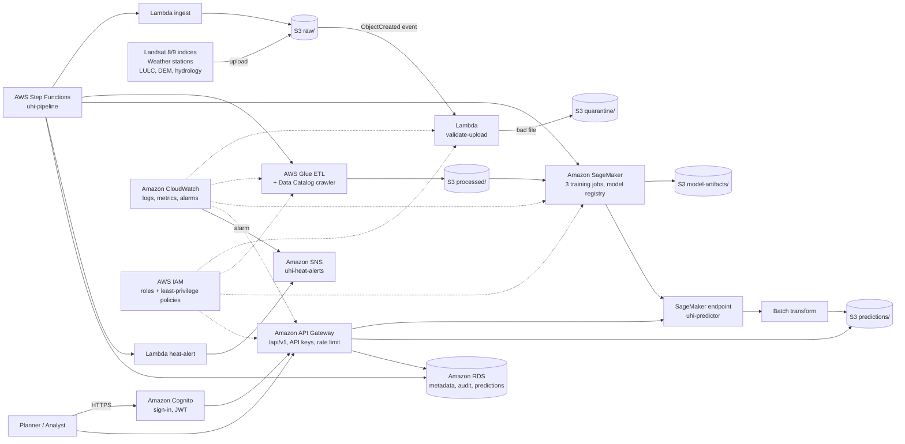

# Cloud-Based Urban Heat Island Prediction Using Geospatial AI

> **BITE412L – Cloud Computing** · Individual project · VIT Vellore
> **Student:** Rohit Kumar (23BIT0030) · **Instructor:** Dr. Priya V
> **Cloud platform:** Amazon Web Services (AWS) · **Study area:** Delhi NCR, India

A complete, runnable cloud platform that ingests satellite and weather data into an
S3 data lake, preprocesses it with Lambda and Glue, trains and deploys Urban Heat Island (UHI)
prediction models with SageMaker, orchestrates the workflow with Step Functions, and serves
predictions through API Gateway, secured by Cognito and IAM, monitored by CloudWatch and alerting via SNS.
Everything is operated from a web **Cloud Console** that looks and behaves like the AWS console.

The whole AWS account is **emulated locally**, so the project runs on any laptop with
**no AWS account and no credit card**. (An internet connection is needed for `pip install`
and, while using the console, for the chart/map libraries and map background tiles.) An optional
script (`scripts/deploy_to_aws.py`) pushes the same data lake, SNS topic and CloudWatch alarm
to a real AWS account.

---

## 1. Quick start (5 minutes)

### What to install (one time)
| Tool | Why | Link |
|---|---|---|
| **Python 3.10 – 3.13** | runs the platform (tick *"Add Python to PATH"* on Windows) | https://www.python.org/downloads/ |
| **Visual Studio Code** | to open and run the project | https://code.visualstudio.com/ |
| VS Code *Python* extension | VS Code suggests it automatically when you open the folder | – |
| Docker Desktop *(optional)* | only if you want to run it as a container | https://www.docker.com/products/docker-desktop/ |

### Run it
1. Extract the zip and open the folder **`UHI_Cloud_Project`** in VS Code (*File → Open Folder*).
2. Start it the easy way:
   - **Windows:** double-click `start_windows.bat`
   - **macOS / Linux:** `./start_mac_linux.sh` in a terminal

   …or manually in the VS Code terminal (*Terminal → New Terminal*):
   ```bash
   python -m venv .venv
   # Windows:  .venv\Scripts\activate        macOS/Linux:  source .venv/bin/activate
   pip install -r requirements.txt
   python run.py
   ```
3. The browser opens **http://127.0.0.1:5000**. Sign in with:
   - **Email:** `admin@uhi.cloud`
   - **Password:** `Admin@123`

On the **first start** the full cloud pipeline runs automatically in the background
(30 – 60 s): it provisions the AWS resources, ingests data, runs the ETL, trains three models,
deploys the best one and generates the heat-risk map. Watch it live on the **Pipeline** page.

> **VS Code tip:** the *Run and Debug* panel (Ctrl+Shift+D) already has launch configurations:
> *UHI Cloud Console*, *reset account*, *Run pipeline only* and *Tests*.

### Useful commands
```bash
python run.py                  # start the console (http://127.0.0.1:5000)
python run.py --port 8080      # use another port
python run.py --reset          # wipe the emulated AWS account and rebuild everything
python run.py --pipeline-only  # run the full pipeline headless, print each stage, exit
pytest -q                      # run the automated test suite (10 tests)
docker compose up --build      # run as a container on http://localhost:5000
```

---

## 2. Problem statement

Urban areas get hotter than their rural surroundings because vegetation is replaced by
heat-absorbing concrete, asphalt and roofs. This **Urban Heat Island** effect raises energy
demand, worsens air quality and increases heat-related illness. Analysing satellite and weather
data for a whole city on one computer is slow, manual and hard to scale. This project builds a
**cloud-based Geospatial AI system** that combines satellite indices, land-surface temperature,
land use, terrain and meteorology to **predict UHI intensity (°C)** for every ~1 km grid cell and
flag heat-prone zones for urban planners.

## 3. Objectives (all implemented)

| # | Objective | Where it is implemented |
|---|---|---|
| 1 | Integrate satellite, LST, vegetation, land-use and meteorological data | `src/ai_model/data_sources.py`, S3 `raw/` zone |
| 2 | Scalable AWS pipeline for storing and preprocessing geospatial data | S3 + Lambda + Glue + Step Functions |
| 3 | Train and evaluate ML models with MAE, RMSE and R² | SageMaker training jobs (`src/ai_model/trainer.py`) |
| 4 | Interpretable heat-risk outputs and maps | Heat Risk Map page, GeoJSON hotspots, feature importance |
| 5 | Secure prediction API and web dashboard | API Gateway (`/api/v1/*`) + Cognito + IAM + Cloud Console |
| 6 | Monitoring and alerting | CloudWatch logs, metrics, alarms + SNS heat alerts |

---

## 4. Cloud architecture



### AWS services used

| AWS service | Role in this project | Console page |
|---|---|---|
| **Amazon S3** | Versioned data lake `uhi-geoai-data-lake` with `raw/`, `processed/`, `model-artifacts/`, `predictions/`, `quarantine/`, `logs/` zones; event notifications, pre-signed URLs, object versions, upload/download | Data Lake (S3) |
| **AWS Lambda** | `uhi-ingest-raw-data`, `uhi-validate-upload` (triggered by S3 events, quarantines bad files), `uhi-heat-alert`; invocations, duration and errors tracked | Pipeline |
| **AWS Glue** | ETL job: cloud masking, Kelvin→°C, rural-reference UHI calculation, inverse-distance weather interpolation, feature join; crawler builds the Data Catalog schema | Pipeline |
| **AWS Step Functions** | `uhi-pipeline` state machine – 10 states from ingestion to metadata recording, with per-state status and timing | Pipeline |
| **Amazon SageMaker** | Training jobs (Linear Regression, Random Forest, Gradient Boosting), model registry with approval status, real-time endpoint `uhi-predictor`, batch transform | SageMaker Models, Predict |
| **Amazon API Gateway** | REST API stage `/api/v1`, 40+ routes, API keys, usage plan / rate limiting, request metrics | API Gateway |
| **Amazon Cognito** | User pool with sign-up, password policy, JWT tokens, groups `admin` / `analyst` / `viewer` | Login, Cognito & IAM |
| **AWS IAM** | Service roles and group roles with least-privilege JSON policies enforced on every API call | Cognito & IAM |
| **Amazon RDS** | Relational metadata DB: datasets, model runs, prediction requests, audit log; read-only SQL console and snapshots | RDS Database |
| **Amazon CloudWatch** | Log groups/streams for every service, custom metrics, dashboards and alarms | CloudWatch |
| **Amazon SNS** | `uhi-heat-alerts` topic, subscriptions, notifications when UHI exceeds the threshold | SNS Alerts |

**Cloud deployment model:** public cloud (AWS, region `ap-south-1` Mumbai).
**Service models:** IaaS (S3 storage), PaaS (Glue, SageMaker, RDS), FaaS / serverless (Lambda, Step Functions, API Gateway), SaaS-style web console for end users.
**Cloud characteristics demonstrated:** on-demand self-service (run pipeline / train / deploy from the browser), resource pooling (one data lake shared by all services), elasticity (stateless API + container image ready for ECS/App Runner), measured service (CloudWatch metrics per call), broad network access (REST API + web console).

### How the emulation works
Every AWS service is a Python module in `src/aws_cloud/` that exposes the same operations as
the real service (`put_object`, `invoke`, `start_job_run`, `create_training_job`,
`invoke_endpoint`, `publish`, …). State is stored in `cloud_runtime/` (the "AWS account"):
S3 objects are real files with versioning metadata, RDS / Cognito / CloudWatch / SNS / API keys
are SQLite databases. Setting `CLOUD_MODE=aws` in `.env` additionally mirrors S3 writes and
SNS messages to a real AWS account through boto3 (`src/aws_cloud/aws_adapter.py`).

---

## 5. Web Cloud Console – pages

| Page | What you can do |
|---|---|
| **Dashboard** | KPIs (cells analysed, mean / max UHI, hotspots, model R²), UHI trend per date, risk distribution, top hotspots, service health |
| **Heat Risk Map** | Interactive Leaflet map of Delhi NCR, colour-coded UHI per grid cell, date selector, click any cell for its features and prediction |
| **Predict UHI** | Click on the map or enter the 11 features with sliders → real-time SageMaker prediction with risk level; "what-if" mitigation (add vegetation, cool roofs); batch CSV upload → results in S3 |
| **Data Lake (S3)** | Browse zones, upload files (triggers the validation Lambda), download, pre-signed URLs, object versions, delete |
| **Pipeline** | Start the Step Functions pipeline, watch the 10 states live, Lambda functions, Glue jobs and Data Catalog |
| **SageMaker Models** | Train new models with custom hyperparameters, compare MAE / RMSE / R² / CV-R², observed vs predicted plots, feature importance, approve and deploy model versions |
| **CloudWatch** | Logs explorer with filters, metrics charts, create / delete alarms |
| **SNS Alerts** | Heat-alert inbox, subscriptions, publish test messages, change alert threshold |
| **RDS Database** | Tables, read-only SQL query console, snapshots, audit log |
| **API Gateway** | Endpoint reference, create / revoke API keys, usage metrics, ready-to-copy `curl` examples |
| **Cognito & IAM** | Users, groups, enable/disable users, change groups, IAM roles and policy JSON |
| **Architecture** | Live architecture diagram and service inventory |

### Using the REST API from outside the console
1. Open **API Gateway → Create API key**, copy the key.
2. Call the API:
   ```bash
   curl -X POST http://127.0.0.1:5000/api/v1/predict \
        -H "x-api-key: <YOUR_KEY>" -H "Content-Type: application/json" \
        -d '{"latitude": 28.6315, "longitude": 77.2167}'
   ```
   Response: `uhi_intensity_celsius`, `risk_level`, the features used, nearest grid cell, model version and latency.

---

## 6. Data

### Study area and grid
Delhi NCR, India (lat 28.40–28.88 °N, lon 76.94–77.38 °E), a **48 × 48 grid (~1 km cells)**,
CRS EPSG:4326, six pre-monsoon Landsat 8/9 acquisition dates:
2023-04-15, 2023-05-17, 2023-06-02, 2024-04-17, 2024-05-19, 2024-06-04.
Model-ready table: **13,362 rows × 19 columns** after cloud masking.

### Raw sources (S3 `raw/` zone)
| File | Content |
|---|---|
| `raw/landsat/LC09_L2SP_<date>_indices.csv` | Landsat Collection-2 Level-2 grid indices: NDVI, NDBI, NDWI, albedo, surface temperature in **Kelvin**, QA cloud flag |
| `raw/meteorology/station_daily.csv` | Daily Tmax, relative humidity and wind at 5 stations (Safdarjung, Palam, Gurugram, Noida, Narela) |
| `raw/static/lulc_dem_hydro.csv` | Land-use class, elevation, distance to the Yamuna / water, urban-density |

The bundled sample is a **physically-calibrated reference sample** so the whole cloud pipeline
runs offline: real urban cores (Connaught Place, Old Delhi, Gurugram Cyber City, Noida…), the
Yamuna river, the Delhi Ridge and Aravalli forests, industrial clusters and the airport are at
their true coordinates, and LST follows published UHI relationships (vegetation cooling,
built-up warming, water cooling, wind dampening, hot-day amplification).

### Using real weather data
```bash
python scripts/fetch_real_weather.py   # downloads real ERA5 data from the Open-Meteo archive (free, no key)
python run.py --reset                  # rebuilds the account with the real station data
```
The script writes `data/real/station_daily.csv`; the ingestion Lambda uses it automatically.
You can also upload your own Landsat / weather CSV exports with the same columns on the
**Data Lake** page – the validation Lambda checks the schema and quarantines bad files.

### Reference datasets
- **Global Urban Heat Island (UHI) Data Set, 2013** – CIESIN / NASA SEDAC, https://doi.org/10.7927/H4H70CRF (reference UHI layer)
- **Landsat 8/9 Collection 2 Level-2** – USGS EarthExplorer, https://earthexplorer.usgs.gov/
- **Open-Meteo Historical Weather API (ERA5)** – https://open-meteo.com/en/docs/historical-weather-api
- Sentinel-2 L2A, ESA WorldCover land cover, SRTM DEM, OpenStreetMap water bodies (supporting layers)

### Features and target
| Feature | Meaning |
|---|---|
| `ndvi` | Normalised Difference Vegetation Index (greenness) |
| `ndbi` | Normalised Difference Built-up Index |
| `ndwi` | Normalised Difference Water Index |
| `albedo` | Surface reflectivity |
| `elevation_m` | Terrain height (m) |
| `distance_to_water_m` | Distance to the nearest water body (m) |
| `urban_density` | Built-up density 0–1 |
| `air_temperature_celsius` | Daily max air temperature (IDW-interpolated from stations) |
| `humidity_percent` | Mean relative humidity |
| `wind_speed_ms` | Mean wind speed (m/s) |
| `lulc_code` | Land-use class: 0 Water, 1 Forest/Ridge, 2 Agriculture, 3 Open land, 4 Low-density urban, 5 High-density urban, 6 Industrial |
| **`uhi_intensity_celsius`** (target) | Cell LST minus the rural-reference LST of the same date |

Heat-risk levels: **Low** < 1 °C ≤ **Moderate** < 3 °C ≤ **High** < 5 °C ≤ **Severe**. An SNS alert fires when UHI exceeds the threshold (default 5 °C, editable on the SNS page).

---

## 7. Machine learning

- **Preprocessing (Glue):** QA cloud masking, Kelvin → °C, rural reference temperature per date, UHI target, IDW interpolation of station weather to every cell, join with static layers, data-quality report.
- **Validation:** *spatial-block split* (8 × 8 cell blocks, 80 / 20) so test cells are geographically separated from training cells, plus 3-fold **GroupKFold** spatial cross-validation – this avoids the over-optimistic scores of random splits on spatial data.
- **Models:** Linear Regression (baseline), Random Forest, Gradient Boosting (HistGradientBoosting). The best model by RMSE is registered, approved and deployed to the endpoint automatically.

Results from a fresh run (held-out spatial test set, 2,983 cells):

| Model | MAE (°C) | RMSE (°C) | R² | Spatial CV R² |
|---|---|---|---|---|
| Linear Regression | 0.611 | 0.794 | 0.948 | 0.68 ± 0.33 |
| Random Forest | 0.557 | 0.702 | 0.959 | 0.83 ± 0.10 |
| **Gradient Boosting (deployed)** | **0.536** | **0.680** | **0.962** | 0.81 ± 0.14 |

The most important driver is land-use class, followed by built-up / vegetation indices – consistent with the UHI literature.

---

## 8. Security

- Cognito sign-in with password policy and signed JWT tokens (8 h expiry); passwords stored as salted PBKDF2 hashes.
- Every API route is checked against **IAM policies** of the user's group (`admin`, `analyst`, `viewer`); new self-registered users can never become admin.
- API keys for programmatic access with a per-minute **rate limit** (usage plan).
- S3 pre-signed URLs are HMAC-signed and expire; object keys are sanitised against path traversal.
- RDS console only allows read-only `SELECT` queries; every sensitive action is written to the audit log.
- Secrets come from `.env` (git-ignored); `.env.example` documents every setting.

---

## 9. Project structure

```text
UHI_Cloud_Project/
├── app.py                     # Vercel serverless entry point (+ vercel.json)
├── run.py                     # entry point: starts the console, first-run pipeline, CLI flags
├── start_windows.bat          # one-click start (Windows)
├── start_mac_linux.sh         # one-click start (macOS / Linux)
├── requirements.txt           # Flask, pandas, NumPy, scikit-learn, joblib, requests, pytest
├── requirements-aws.txt       # + boto3 for real-AWS mode
├── Dockerfile, docker-compose.yml, .dockerignore
├── .env.example               # all configuration options
├── .vscode/                   # launch configs, settings, recommended extensions
├── src/
│   ├── config.py              # project, study area, features, risk levels, settings
│   ├── aws_cloud/             # emulated AWS services
│   │   ├── s3.py  lambda_service.py  glue.py  step_functions.py  sagemaker.py
│   │   ├── api_gateway.py  cognito.py  iam.py  rds.py  cloudwatch.py  sns.py
│   │   └── aws_adapter.py     # optional bridge to a real AWS account
│   ├── lambdas/handlers.py    # Lambda function code (ingest, validate, heat alert)
│   ├── ai_model/
│   │   ├── data_sources.py    # raw data acquisition (Landsat indices, weather, static layers)
│   │   ├── preprocessing.py   # Glue ETL logic
│   │   └── trainer.py         # model training, spatial validation, metrics
│   ├── backend/
│   │   ├── app.py             # Flask app = API Gateway stage + console pages
│   │   └── cloud_setup.py     # resource provisioning + Step Functions definition
│   └── frontend/              # HTML templates, CSS, JavaScript (Leaflet, Chart.js)
├── infrastructure/cloudformation/uhi-aws-stack.yaml   # real AWS resources (IaC)
├── scripts/
│   ├── fetch_real_weather.py  # download real ERA5 weather (Open-Meteo)
│   └── deploy_to_aws.py       # optional: deploy S3 / SNS / CloudWatch to real AWS
├── tests/                     # pytest end-to-end tests
├── docs/                      # Phase I planning: overview, AWS service plan, roadmap, checklist
├── architecture/              # AWS and complete-system architecture documents
├── dataset/data_dictionary.md # field definitions
├── literature_survey/         # 15-paper literature survey + research-gap analysis
├── references/sources.md      # dataset and paper references
└── cloud_runtime/             # created on first run: the emulated AWS account (git-ignored)
```

---

## 10. Optional: deploy to a real AWS account

```bash
pip install -r requirements-aws.txt
aws configure                                   # your access key, secret, region ap-south-1
python scripts/deploy_to_aws.py --dry-run       # preview
python scripts/deploy_to_aws.py --email you@example.com
```
This creates the S3 bucket (versioning, AES-256 encryption, public-access block) and uploads the
data lake, creates the SNS topic with an e-mail subscription, and a CloudWatch alarm. Then set
`CLOUD_MODE=aws` in `.env` so new uploads and alerts are mirrored live. Remove everything with
`python scripts/deploy_to_aws.py --destroy`. All of this stays within the AWS Free Tier for this data size.

The Docker image (`docker compose up --build`) is ready to run on **Amazon ECS / AWS App Runner**.

---

## 10b. Live deployment on Vercel (serverless)

The project is also deployed as a **serverless function on Vercel**, connected to the GitHub repo
(every push to the repo's default branch redeploys automatically).

| File | Purpose |
|---|---|
| `app.py` | Serverless entry point (auto-detected by Vercel's Flask preset) – exposes the Flask app; on a cold start it provisions the emulated AWS account in `/tmp` and runs the Step Functions pipeline once (~20–40 s) |
| `vercel.json` | Sets the function's 300 s max duration and excludes docs and tests from the bundle |
| `.vercelignore` | Keeps local state and virtual environments out of uploads |

Serverless notes: the code directory is read-only, so state lives in `/tmp` (set automatically when
`VERCEL` is present). Each new serverless instance builds its own account on its first request,
so the **first page load after a quiet period takes ~30 s**; after that it is instant. Uploaded files,
new users and API keys are per-instance and reset when Vercel recycles the instance; this is a demo deployment.
Random Forest uses 60 trees on serverless (120 locally) to fit the CPU limits.

## 10c. Host the platform on AWS EC2 (one-click setup)

`scripts/aws_ec2_setup.sh` turns a fresh Ubuntu EC2 server into a running UHI platform:
it installs Python, Git and Nginx, adds swap, clones this repo, installs requirements,
creates `.env` with a random secret, runs the app as a **systemd** service (auto-restart,
starts on reboot) behind **Nginx on port 80**.

1. AWS console → region **Asia Pacific (Mumbai) ap-south-1** → **EC2 → Launch instance**
2. Name `uhi-cloud-server`, AMI **Ubuntu Server 24.04 LTS**, type **t3.small**
   (or free-tier **t3.micro / t2.micro**: works thanks to the swap file, training is slower)
3. Key pair: create one (needed only for SSH)
4. Network settings: tick **Allow SSH** and **Allow HTTP traffic from the internet**
5. Storage: 12 GiB or more
6. **Advanced details → User data**: paste the entire contents of `scripts/aws_ec2_setup.sh`
7. **Launch instance**, wait 5–8 minutes, then open `http://<Public IPv4 address>`
   (the first page load may wait 1–2 minutes while the pipeline trains the models)

Useful commands after `ssh -i key.pem ubuntu@<ip>`:

```bash
sudo tail -f /var/log/uhi-setup.log                 # watch the setup
sudo journalctl -u uhi -f                           # application logs
sudo bash /opt/uhi/scripts/aws_ec2_setup.sh         # update to the latest GitHub commit
sudo systemctl restart uhi                          # restart the app
```

Unlike Vercel, data, users and API keys persist on the server's disk. **Stop or terminate the
instance after your demo** to avoid charges, and set an AWS Budget alert.
Combine with section 10 (`deploy_to_aws.py`, `CLOUD_MODE=aws`) to also mirror the data lake
and alerts to real S3 / SNS / CloudWatch: attach an IAM role with S3, SNS and CloudWatch access
to the instance and set `CLOUD_MODE=aws` in `/opt/uhi/.env`.

## 10d. Real AWS services with CloudFormation (recommended for the demo)

`infrastructure/cloudformation/uhi-aws-stack.yaml` creates **real, free-tier-friendly AWS resources** in one step:

| Real AWS service | Resource | Used for |
|---|---|---|
| AWS CloudFormation | stack `uhi-cloud` | Infrastructure as Code: creates and deletes everything below |
| Amazon S3 | `uhi-geoai-data-lake-<account>-ap-south-1` | Real copy of the data lake (versioned, encrypted, private) |
| AWS Lambda | `uhi-heat-alert-checker` | Reads the latest predictions, publishes metrics and e-mail alerts |
| Amazon EventBridge | rule `uhi-daily-heat-check` | Runs the Lambda every day at 06:00 IST |
| S3 event notification | `predictions/*.geojson` | Runs the Lambda automatically after every pipeline run |
| Amazon SNS | topic `uhi-heat-alerts` | Real e-mail heat alerts |
| Amazon DynamoDB | table `uhi-predictions` | Every prediction request made in the console or the API |
| Amazon CloudWatch | log group `/uhi/platform`, alarm `uhi-severe-heat-cells`, dashboard `UHI-GeoAI-Operations` | Real logs, metrics, alarm and dashboard |
| AWS Systems Manager | Parameter Store `/uhi/config` | Tells the platform which resources to use |
| AWS IAM | role and instance profile `uhi-ec2-...` | Least-privilege access for the EC2 server (no access keys anywhere) |
| Amazon EC2 | your instance (section 10c) | Runs the platform |

**Steps (AWS console, region Asia Pacific (Mumbai))**

1. **CloudFormation → Create stack → With new resources** → *Upload a template file* → choose
   `infrastructure/cloudformation/uhi-aws-stack.yaml` → Next.
2. Stack name `uhi-cloud`, **AlertEmail** = your e-mail → Next → Next → tick
   *"I acknowledge that AWS CloudFormation might create IAM resources with custom names"* → **Submit**.
   Wait for **CREATE_COMPLETE** (2–3 minutes), then **confirm the SNS e-mail** AWS sends you.
3. **EC2 → Instances →** select your instance → **Actions → Security → Modify IAM role** →
   choose `uhi-ec2-instance-profile-ap-south-1` → **Update IAM role**.
4. On the server (EC2 Instance Connect), re-run the setup. It detects the role and switches to `CLOUD_MODE=aws`:
   ```bash
   curl -fsSL https://raw.githubusercontent.com/rohitpawalia28/CloudBasedUrbanHeatIslandPrediction_Azure_Cloud_Project_2026/main/scripts/aws_ec2_setup.sh | sudo bash
   ```
5. Open the site → **Pipeline → Run cloud pipeline**. The data lake is uploaded to the real S3 bucket, and the new
   predictions trigger the real Lambda, which updates CloudWatch and e-mails you an SNS alert.
6. Open the new **Real AWS** page in the console: live counters for S3, SNS, DynamoDB, CloudWatch and Lambda,
   direct links into the AWS console, and an **Invoke real Lambda** button.

**Cost and clean-up:** everything above stays within the AWS free allowances at this data size (only UHI/* metrics
are sent to CloudWatch, the DynamoDB table uses 5 read / 5 write units, logs are kept for 7 days).
To remove it: empty the S3 bucket (S3 → bucket → **Empty**), then **CloudFormation → uhi-cloud → Delete**, and
terminate the EC2 instance.

## 11. Troubleshooting

| Problem | Fix |
|---|---|
| `python` not found (Windows) | Reinstall Python and tick **Add Python to PATH**, or use `py` instead of `python` |
| Port 5000 already in use (macOS AirPlay) | `python run.py --port 8080` |
| Scripts blocked in PowerShell | `Set-ExecutionPolicy -Scope CurrentUser RemoteSigned`, or use Command Prompt |
| Dashboard empty | Wait for the first pipeline to finish (Pipeline page), or run `python run.py --reset` |
| Something looks broken | `python run.py --reset` rebuilds the whole emulated account from scratch |
| Forgot login | `admin@uhi.cloud` / `Admin@123` (change in `.env`) |

---

## 12. Limitations and future work

- Surface UHI from satellite LST is not the same as air-temperature UHI; outputs are for decision support only.
- The bundled data is a calibrated reference sample; swapping in full Landsat scenes (Google Earth Engine / USGS export) and real station data improves realism.
- Future: night-time UHI with MODIS, Sentinel-2 10 m features, SHAP explanations, PostGIS for spatial SQL, Terraform for infrastructure-as-code.

## 13. References
See `references/sources.md` and `literature_survey/literature_survey.md` for the full 15-paper survey and dataset citations.

---
*Academic project – do not commit real AWS credentials, `.env` files or large raw datasets to GitHub.*
