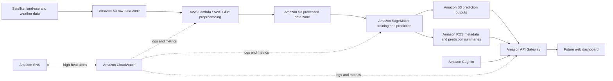

# Cloud-Based Urban Heat Island Prediction Using Geospatial AI

> BITE412L - Cloud Computing | Phase I Planning Repository

| Student | Registration No. | Project type | Instructor |
|---|---|---|---|
| Rohit Kumar | 23BIT0030 | Individual project | Dr. Priya V |

## Project status

**Phase I - planning and documentation complete.** No source-code implementation is included at this stage, as required for the first review. This repository documents the planned cloud workflow, data sources, research review, architecture, and future implementation structure.

## Problem statement

Urban areas can experience higher land surface temperatures than surrounding rural areas because vegetation is reduced and heat-absorbing built surfaces increase. Analysing large satellite and weather datasets locally is slow, manual, and difficult to scale. This project proposes a cloud-based Geospatial AI system that will combine satellite imagery, land surface temperature, vegetation, built-up, land-use, and meteorological data to predict Urban Heat Island (UHI) intensity and identify heat-prone urban zones.

## Objectives

1. Integrate satellite, land surface temperature, vegetation, land-use, and meteorological data for UHI analysis.
2. Design an AWS-based, scalable pipeline for storing and preprocessing geospatial data.
3. Train and evaluate machine-learning models to predict UHI intensity using MAE, RMSE, and R-squared.
4. Generate interpretable heat-risk outputs and maps for urban-planning support.
5. Expose prediction results through a secure API and future web dashboard.
6. Monitor processing, model-serving, and alerting workflows through managed cloud services.

## Proposed AWS framework



See the full diagrams in [architecture/](architecture/README.md).

## Technology stack

| Area | Planned technology |
|---|---|
| Cloud platform | Amazon Web Services (AWS) |
| Object storage | Amazon S3 |
| Preprocessing | AWS Lambda, AWS Glue, Python |
| Machine learning | Amazon SageMaker, scikit-learn / XGBoost |
| Relational metadata | Amazon RDS (PostgreSQL with PostGIS, if required) |
| API and authentication | Amazon API Gateway, Amazon Cognito |
| Monitoring and notifications | Amazon CloudWatch, Amazon SNS |
| Geospatial tools | GeoPandas, Rasterio, GDAL, QGIS |
| Future frontend | React, Leaflet / MapLibre |

## Dataset plan

The primary reference dataset is the **Global Urban Heat Island (UHI) Data Set, 2013** from NASA SEDAC/CIESIN. It provides urban and rural land-surface-temperature estimates and urban-rural differences. Supporting data will include Landsat/Sentinel imagery, land-use/land-cover layers, and meteorological data. Full details are in [dataset/README.md](dataset/README.md).

## Repository layout

```text
.
|-- docs/                 # Project documentation, service plan, workflow, and checklist
|-- literature_survey/    # Individual 15-paper survey and research-gap analysis
|-- architecture/         # AWS and complete-system architecture diagrams
|-- dataset/              # Dataset plan and data dictionary
|-- src/                  # Placeholder modules for future implementation
|-- results/              # Future model outputs and evaluation reports
|-- presentation/         # Future review slides
`-- references/           # Dataset and research-paper references
```

## Important repository-name note

The course guideline specifies the repository suffix `Azure_Cloud_Project_2026`, so this repository follows that naming format. The submitted Review 1 documentation and the written guideline sections specify **AWS services**, therefore the proposed architecture and service plan use AWS consistently.

## Key documents

- [Project overview](docs/project_overview.md)
- [Individual work distribution](docs/work_distribution.md)
- [AWS services plan](docs/aws_services_plan.md)
- [Dataset details](dataset/README.md)
- [Literature survey - 15 papers](literature_survey/literature_survey.md)
- [Individual research-gap analysis](literature_survey/research_gap_analysis.md)
- [Architecture diagrams](architecture/README.md)
- [Solo Git workflow](docs/git_workflow.md)

## Planned implementation sequence

1. Select study city and acquire the approved data subset.
2. Upload raw data to the S3 raw-data zone and record data versioning metadata.
3. Automate cleaning, alignment, feature extraction, and model-ready-table creation.
4. Train baseline and ensemble regression models in SageMaker.
5. Evaluate models, store output layers, and publish the best approved model through an API.
6. Build the dashboard only after the data and prediction pipeline are validated.

## License

This repository contains academic project planning material. Do not upload restricted data, cloud credentials, API keys, or large raw datasets to GitHub.
