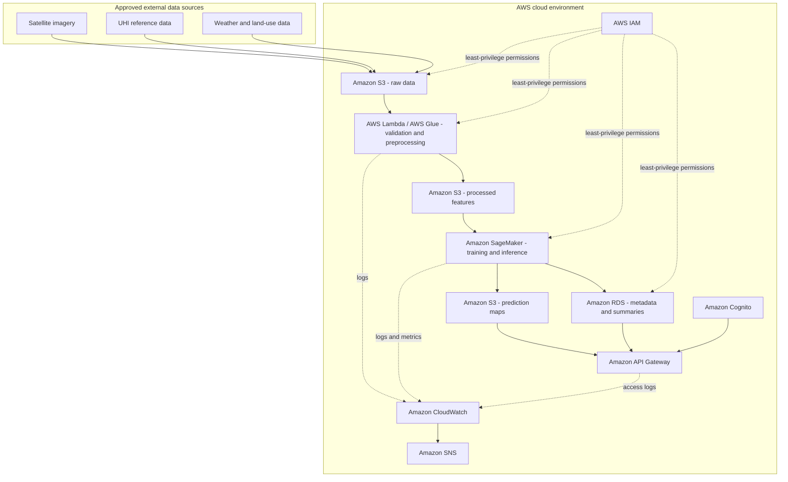

# Diagram 1 - AWS Cloud Architecture

## Data-flow explanation

1. Approved external data is placed in the S3 raw-data zone.
2. Lambda or Glue validates inputs, removes invalid records, aligns spatial data, and creates model-ready features.
3. Processed features are stored separately from source data and passed to SageMaker.
4. SageMaker trains or invokes a model and writes map outputs to S3 plus queryable metadata to RDS.
5. API Gateway provides approved output to the future frontend; Cognito controls user access.
6. CloudWatch records operational events; SNS sends configured notifications.
