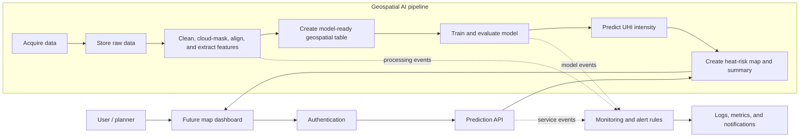

# Diagram 2 - Complete System Architecture

## Workflow explanation

1. The student selects an approved city, time range, and data sources.
2. Raw source data is stored without modifying the original files.
3. Preprocessing performs quality checks, cloud masking where relevant, spatial alignment, normalisation, and feature extraction.
4. A model-ready table is created from the spatial features.
5. Baseline and advanced models are trained and compared using MAE, RMSE, and R-squared.
6. The best validated model produces UHI-intensity estimates and heat-risk map layers.
7. The dashboard retrieves only approved outputs through a protected API.
8. Monitoring records pipeline or service failure and can trigger notifications.
